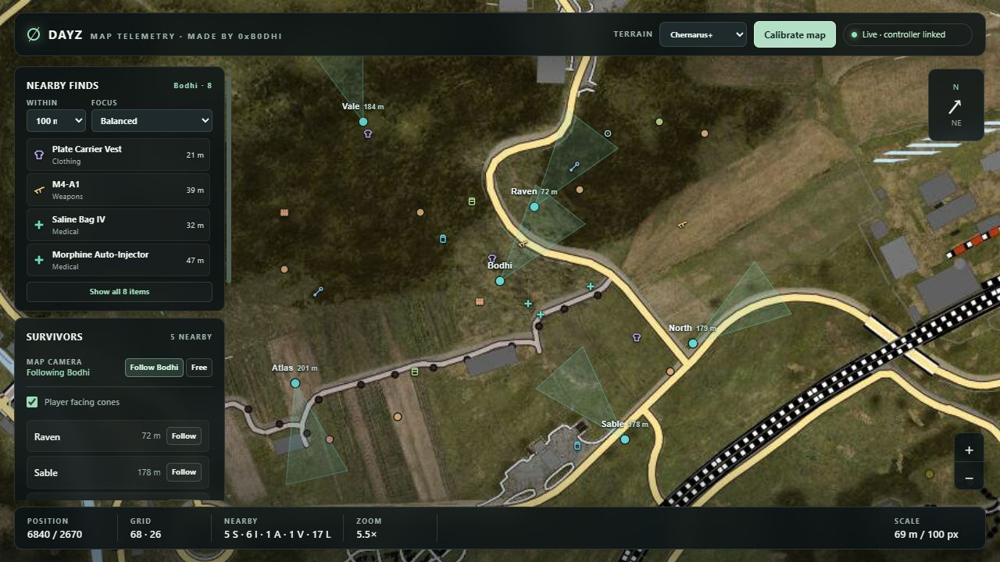

# DayZ Helper

Minimalist DayZ overlay and browser map viewer.

The Windows controller renders configurable visualizations with Direct3D 11 and Dear ImGui. A separate local server publishes completed map snapshots to browser clients so other players can view the map from their own devices.

> **Public source preview:** Game-data acquisition is a placeholder. This repository contains no kernel driver, IOCTL implementation, or live memory reader. Live visualizations will not populate until a compatible data source is integrated. Fake-memory tests cover sampling and projection without a game process.

## Features

- **Overlay:** entity boxes, labels, skeleton lines, item categories and distance gates, compact item callouts, coordinates, heading, and an in-game settings panel.
- **Map viewer:** player positions and facing, names, distances, held items, item-category symbols, nearby finds, per-viewer follow controls, and a survivor list.
- **Configuration:** visualization toggles, category filters, colors, distance limits, and hotkeys in `dayz.ini`.
- **Testing:** deterministic fake-memory tests for sampling, projection, filtering, and map packets. A sample publisher exercises the browser UI without a game process.

## Preview



*Illustrative map viewer mockup. Terrain imagery is not bundled in this repository.*

<!-- Add an overlay screenshot here: docs/screenshots/overlay.png -->

## Build

On Windows x64, install Visual Studio C++ build tools and the Windows SDK. From the repository root:

```powershell
.\build-user.cmd
.\build-maptelemetry.cmd
.\out\dayz-game-tests.exe
.\out\maptelemetry-tests.exe
```

`build-user.cmd` creates a local `dayz.ini` from the tracked example. The public overlay opens without a live data source; its entity visualizations remain empty. To preview the browser UI, start the map server:

```powershell
.\out\maptelemetry-server.exe
```

Open the URL printed by the server. In a second PowerShell window, send a sample frame:

```powershell
.\out\maptelemetry-tests.exe --layers-fixture
```

The server retains the sample frame after the publisher exits and marks it disconnected. See the [map viewer guide](maptelemetry/README.md) for terrain-image setup and sharing details.

## How it fits together

| Part | Role |
| --- | --- |
| `src/data/` | The public data-source boundary; reads always fail without changing caller output. |
| `src/game/` | Projection, skeleton and item logic, prediction math, and the versioned map packet. |
| `src/app/` | Frame lifecycle, filtering, configuration, and map publication. |
| `src/overlay/` | Direct3D 11 and Dear ImGui drawing; it consumes completed frames. |
| `maptelemetry/` | Local named-pipe receiver, browser server, and web interface. |
| `tests/` | Deterministic fake-memory and map-packet tests. |

The map server receives complete snapshots over a local named pipe and sends them to browser clients. It does not open the game or read memory. Generated terrain tiles and local access settings are not tracked; missing tiles use a schematic grid.

## Project notes

The configuration example targets **DayZ 1.30.164200.56**. Structure names and offsets are build-specific research material. See [research notes](docs/REVERSE_ENGINEERING.md) for how candidate notes, static analysis, and live validation are tracked.

This is an independent project and is not affiliated with Bohemia Interactive. Dear ImGui, Leaflet, and CivetWeb retain their upstream licenses in `third_party/` and `maptelemetry/web/vendor/`.
